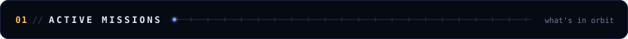
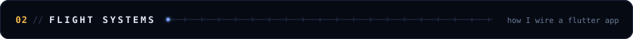
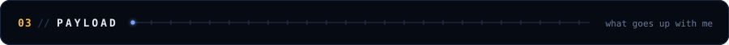
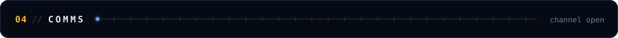

<!--
  knowmeasGaurav / profile README
  Concept: mission control. Header is a live console (boot log, orbit view, MET clock, telemetry ticker).
  Every panel is a hand-built SVG in assets/, animated with SMIL. No JavaScript, no web fonts.
  Edit and rebuild with: python scripts/build_svgs.py
-->

  

<!-- MISSIONS:START -->
<table>
  <tr>
    <th align="left">ID</th>
    <th align="left">MISSION</th>
    <th align="left">LOG</th>
    <th align="right">STATUS</th>
  </tr>
  <tr>
    <td><code>M-00</code></td>
    <td><b>CampusLink</b> Flutter</td>
    <td>Sole frontend dev at an early-stage student startup. Every screen goes through me.</td>
    <td align="right"><code>ACTIVE</code></td>
  </tr>
  <tr>
    <td><code>M-01</code></td>
    <td><b>Unix shell</b> C++</td>
    <td>Built from scratch in C++. Bash was taken.</td>
    <td align="right"><code>LAUNCHED</code></td>
  </tr>
  <tr>
    <td><code>M-02</code></td>
    <td><b>Fitness tracker + AI coach</b></td>
    <td>Logs every rep. Judges quietly.</td>
    <td align="right"><code>LAUNCHED</code></td>
  </tr>
  <tr>
    <td><code>M-03</code></td>
    <td><a href="https://github.com/knowmeasGaurav/multi-agent-research-assistant"><b>Multi-agent research assistant</b></a> Python</td>
    <td>The agents do the reading. You get the answer.</td>
    <td align="right"><code>DEPLOYED</code></td>
  </tr>
  <tr>
    <td><code>M-04</code></td>
    <td><a href="https://github.com/knowmeasGaurav/Weather-app"><b>Weather app</b></a> C++</td>
    <td>A simple weather app built with Flutter and a weather API to display real-time weather information. Created as a learning project while exploring Flutter and mobile app development.</td>
    <td align="right"><code>LAUNCHED</code></td>
  </tr>
</table>
<!-- MISSIONS:END -->

<table>
  <tr>
    <th align="left">CHANNEL</th>
    <th align="left">OPEN WHEN</th>
  </tr>
  <tr>
    <td><code>HIRE</code> <a href="mailto:gaurav56gupta69@gmail.com">gaurav56gupta69@gmail.com</a></td>
    <td>you need one person to take a Flutter app from empty repo to shipped</td>
  </tr>
  <tr>
    <td><code>BUILD</code> <a href="https://www.linkedin.com/in/gauravgupta04-/">linkedin</a></td>
    <td>your startup needs a frontend that still holds up after launch day</td>
  </tr>
  <tr>
    <td><code>TALK</code> <a href="https://github.com/knowmeasGaurav">github</a></td>
    <td>you want to argue about state management. Bring evidence.</td>
  </tr>
</table>

